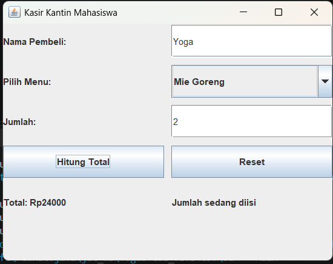

# Aplikasi Kasir Kantin Mahasiswa

**Nama:** Yoga Adiguna  
**NIM:** F1D02410028  
**Mata Kuliah:** Pemrograman Berorientasi Objek  
**Materi:** Graphical User Interface (GUI) - Eksplorasi Lanjutan

## 1. Deskripsi Program
Program ini merupakan aplikasi kasir kantin mahasiswa sederhana yang dibuat menggunakan Java Swing. Aplikasi ini berfungsi untuk menghitung total harga pembelian makanan atau minuman berdasarkan pilihan menu dan jumlah yang diinputkan oleh pengguna, dilengkapi dengan validasi input dan informasi interaktif secara *real-time*.

---

## 2. Top-level Container Class
Top-level container adalah wadah utama yang menyediakan jendela tempat seluruh komponen GUI diletakkan. Pada program ini, komponen yang digunakan adalah **JFrame**.

```java
public class KasirGUI extends JFrame implements ActionListener {

## 7. Screenshot Hasil Program

Berikut merupakan screenshot hasil tampilan aplikasi Kasir Kantin Mahasiswa:

